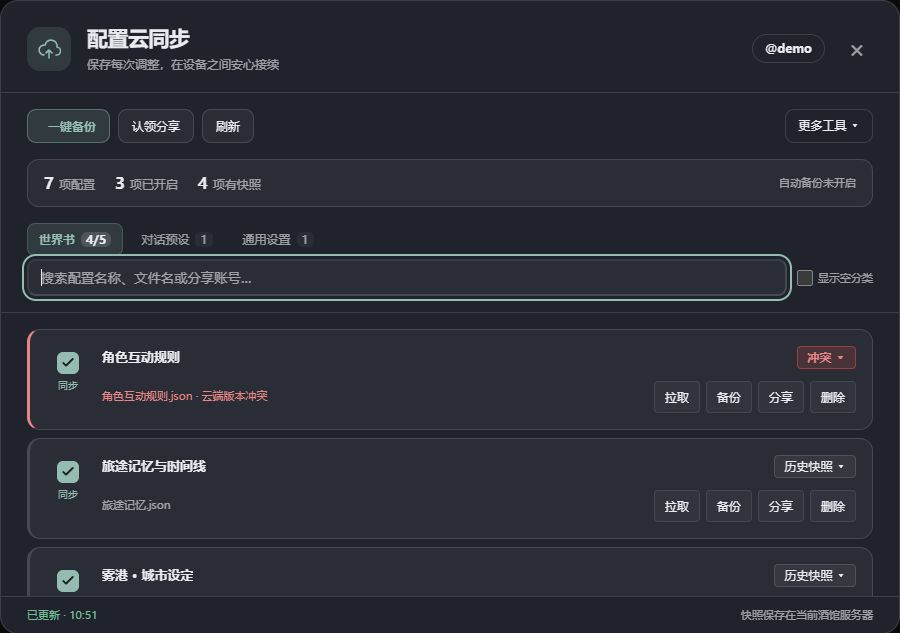
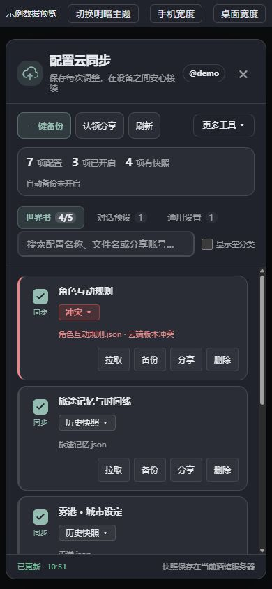

# SillyTavern CloudConfig · 配置云同步

[](./LICENSE)
[](./package.json)
[](https://github.com/SillyTavern/SillyTavern)

为 SillyTavern（酒馆）的预设、世界书、角色卡和其他配置提供版本备份、拉取恢复、跨账号只读分享与可选外部镜像。

插件由 **服务端插件和浏览器前端扩展** 两部分组成。默认的“云端”是当前酒馆服务器上的版本库；需要异地副本时，可以另外配置 WebDAV 或本地/NAS 挂载目录。

## 界面预览

界面跟随酒馆的文字、背景和强调色，支持明暗主题与手机布局。卡片将同步勾选、名称、来源与操作分区显示，独立勾选标记避免宿主主题遮挡。下面使用示例数据，不代表你的真实账号或预设。



<details>
<summary>查看手机布局</summary>



</details>

## 主要功能

- **单项及批量备份**：为快照添加备注；单项点击“备份”，批量处理已勾选的本人配置。
- **版本历史**：查看快照名称、时间和大小，拉取指定版本，锁定需要长期保留的版本。
- **冲突保护**：普通手动备份、批量备份和自动备份检查云端版本，冲突时交由用户处理；手动备份可明确选择强制上传。
- **本地恢复**：开启同步时保存浏览器本地备份，关闭时可保留现状或恢复开启前的内容。
- **跨账号分享**：邀请码认领、公开只读与授权撤销；共享对象显示来源账号，不能替所有者备份、分享或删除。
- **实时通知**：SSE 通知配合增量轮询，分页处理大量变更，按账号区分绑定与事件。
- **自动备份与定时灾备**：浏览器空闲时备份已开启的本人配置；服务端可在浏览器关闭后继续定时生成归档。
- **存储管理**：查看个人/管理员全局统计，预览并清理已删除对象的未锁定历史快照。

快照先写入不可变文件，再通过 SQLite 事务发布版本与事件。并发强制上传分别分配版本；删除历史后不重用已发布的版本号。更详细的实现与验证记录见 [可靠性与界面改造说明](./docs/implementation-2026-10-14.md)。

## 安装

### 环境要求

- **Node.js 24 或更新版本**：代码直接使用内置 `node:sqlite`，Node 18/20 不适用。
- **Git**：用于安装和更新仓库。
- **SillyTavern 1.18.0 或兼容该插件接口的版本**，开启用户账号与服务端插件。
- 浏览器需要支持 IndexedDB。插件自身使用 Node 内置 SQLite，不依赖额外的 `node-gyp` 编译驱动。

Android/Termux 部署同样需要满足 Node.js 24+；请先检查 `node --version`。当前验证环境为 Windows / Node.js 24.21.0，其他宿主环境的加载与刷新行为需实机检查。

### 1. 开启酒馆功能

编辑酒馆根目录的 `config.yaml`：

```yaml
enableUserAccounts: true
enableServerPlugins: true
```

### 2. 安装服务端插件

在酒馆根目录执行：

```sh
git clone https://github.com/zgy-beep/SillyTavern-CloudConfig.git plugins/cfgsync
cd plugins/cfgsync
npm ci
cd ../..
```

随后重启酒馆。服务端初始化完成后会输出：

```text
[SillyTavern-CloudConfig] Initializing v0.1.0...
[SillyTavern-CloudConfig] Initialization complete.
```

接口前缀为 `/api/plugins/cfgsync`，来自代码里的插件 ID `cfgsync`。目录名本身不决定接口前缀；宿主的加载行为可参考 [SillyTavern 服务端插件加载器](https://github.com/SillyTavern/SillyTavern/blob/release/src/plugin-loader.js)。

### 3. 安装前端扩展

在酒馆顶部打开 **扩展 → 安装扩展**，填入同一仓库地址：

```text
https://github.com/zgy-beep/SillyTavern-CloudConfig.git
```

安装后刷新页面，并确认扩展已经启用。第三方扩展通过 Git 仓库安装的入口见 [酒馆官方扩展说明](https://docs.sillytavern.app/extensions/)。

也可手工把以下文件复制到酒馆的公共前端扩展目录，保留结构：

```text
public/scripts/extensions/third-party/cfgsync/
├── manifest.json
└── src/
    ├── client/     # 完整目录，包含 UI、CSS 和客户端模块
    └── common/     # 前端依赖的公共模块
```

**仅安装 `plugins/cfgsync` 服务端目录不会自动把面板注册为前端扩展。** 前后端都加载后，在“扩展设置”中展开“配置云同步”，点击“打开面板”。

不要把服务端数据目录复制到公共前端目录。通过 Git 分别安装前后端时，它们是两个副本，更新时也需要同步更新。

### 更新已有安装

服务端在自己的插件目录执行：

```sh
git pull --ff-only
npm ci
```

前端在“管理扩展”中更新，或重新同步手工复制的 `manifest.json`、`src/client`、`src/common`。然后重启酒馆并刷新浏览器。

首次启动会迁移旧插件数据目录，并自动创建新增数据库表。升级前可保存一份现有插件数据副本；不需要手工编辑数据库模式。

## 预设分类是什么意思

| 面板名称 | 内部类型 | 用途及来源 |
| --- | --- | --- |
| **对话预设** | `openai_preset` | 就是酒馆的**对话补全预设 / Chat Completion Preset**。包含聊天补全参数、提示词与排列设置，扫描当前账号的 `OpenAI Settings` JSON 文件。这个历史目录名也用于其他聊天补全来源。 |

在酒馆里寻找对话补全预设：选择 **Chat Completion / 对话补全** 连接类型，然后打开顶部 **AI 回复配置** 面板，查看预设下拉框。提示词管理器也位于这个面板，参见 [官方提示词管理器说明](https://docs.sillytavern.app/usage/prompts/prompt-manager/)。

Novel 预设、Kobold 预设、指令模板、上下文模板、系统提示词和文本生成预设已从同步界面移除；旧绑定不参与批量或自动备份。已有云端历史与灾备内容保留，服务端适配器用于兼容旧数据。

其余有本地文件或云端快照的分类默认显示，不需要额外勾选“更多分类”。**“显示空分类”** 仅用于查看当前没有文件的其他类型。

## 支持的数据与默认版本数

下表说明“拉取云端内容到本地”时的主要策略。实际扫描目录优先使用酒馆为当前登录账号提供的目录。

| 类型 | 内容 | 拉取策略 | 默认保留 |
| --- | --- | --- | ---: |
| `settings` | 通用设置 `settings.json` | 深度合并，保留本地独有键 | 20 |
| `openai_preset` | 对话补全预设 JSON | 替换 | 20 |
| `world` | 世界书 JSON | 替换 | 20 |
| `quick_replies` | 快捷回复 JSON | 替换 | 20 |
| `character` | PNG / JSON 角色卡 | 原始字节替换，覆盖前备份 | 5 |
| `theme` | 主题 JSON | 替换 | 5 |
| `chat` / `group_chat` | JSONL 会话记录 | 消息并集、swipes 合并，只增不减 | 5 |
| `background` | 背景图片 | 替换 | 3 |
| `avatar` | 人设头像 | 替换 | 5 |
| `persona` | `personas` 目录中的独立人设 JSON | 替换 | 20 |
| `group` | 群组定义 JSON | 替换 | 20 |
| `sprites` | 表情贴图 ZIP | 增量写入，保留本地独有文件 | 3 |

角色卡扫描当前支持 PNG 和 JSON；此处不承诺 WebP 导入。若酒馆的人设信息保存在 `settings.json` 内，可通过通用设置备份；`persona` 适配器扫描的是独立 JSON 目录。

普通类型使用全局版本上限；部分资产有按类型的上限。已锁定版本不会被自动轮转，因此实际保留数量可能超过上限。

## 日常使用

### 备份与版本恢复

1. 在面板选择分类，搜索配置名称、文件名或来源账号。
2. 单个文件直接点击 **备份**，填写快照备注并上传；无需预先勾选。
3. 想纳入批量/自动备份的项目，勾选该行开关，再点击顶部 **一键备份**。
4. 点击 **拉取** 获取最新云端内容；点击 **历史快照** 选择具体版本、锁定快照或删除历史。

单项备份会为项目建立同步绑定，并在本地已有文件时保存开启前的备份。备份与拉取是不同操作：备份把本地内容存入版本库，拉取才把云端内容应用到当前账号的酒馆文件。

拉取通用设置后，独有本地键和云端未提供的键会保留；数组通常按标识或值保留本地独有项。拉取聊天记录会合并消息，可能把本地删除过的消息重新带回。设置、API 密钥或资产的运行期缓存可能需要刷新页面或重启酒馆后才完整生效，以操作后的提示为准。

### 遇到云端冲突

默认备份使用 CAS 版本检查。云端已被其他设备修改时，可以选择拉取云端、确认以本地内容继续提交，或取消处理。

手动备份弹窗中的 **“允许将本地旧内容设为云端最新”** 默认不勾选。勾选后会跳过版本冲突检查，也可以重新发布曾被删除的对象；已有历史仍受保留上限与快照锁定策略管理。

### 关闭同步与本地备份

关闭开关时，可以选择保留当前配置，或恢复开启同步前保存的本地备份。原始内容恢复不使用普通云端拉取的设置/聊天合并策略。

本地备份保存在**当前浏览器的 IndexedDB**，并按账号及来源绑定区分。清除站点数据或更换浏览器不会携带这些备份；如果开启时本地没有对应文件，也没有开启前内容可恢复。服务端版本历史是另一份独立存储。

### 设置精简

默认精简会排除 `oai_settings.extensions.tavern_helper` **整个分支**，包含其中的助手变量、脚本及缓存。需要把这些内容一并存入快照时，请取消精简勾选。精简只作用于快照，不修改原始本地文件；精简后的快照不能用于恢复被排除的助手内容。

## 分享与权限

本人配置可以生成邀请码，或设为对服务器内已登录用户公开只读。认领后的共享项会单独显示来源账号，即使它和自己的配置同名，也不会合并为同一行。

共享项允许拉取，不能替所有者备份、再次分享或删除。分享者可撤销授权；邀请码支持单次/多次使用及过期控制。

- **通用设置共享默认关闭**，管理员需要在“更多工具 → 同步设置”中启用。
- 分享设置时，可另外选择受控密钥注入。经服务端验证授权后，拉取设置可合并所有者的 `secrets.json` 密钥到接收账号。密钥分享会让接收者具备使用相应凭据的能力，应按实际需要选择。
- 聊天与群聊记录默认不开放跨账号分享。
- 全局配置修改需要管理员权限。WebDAV 密码不会通过配置读取接口返回；密码输入留空保留原值。普通成员另外看不到 WebDAV 用户名、地址和本地镜像路径。

## 自动备份、镜像与灾备

| 功能 | 在哪里开启 | 运行条件 | 内容 |
| --- | --- | --- | --- |
| 浏览器自动备份 | 同步设置中的本机偏好 | 浏览器页面运行且空闲 | 已勾选的本人配置；跳过相同内容，遇到冲突暂停对应项 |
| 服务端定时灾备 | 管理员同步设置 | 酒馆服务运行，浏览器可关闭 | 已进入插件版本库的全体账号记录与关联快照 |
| 外部镜像 | 管理员同步设置 | 启用 LocalPath 或 WebDAV | 在本地提交后异步复制快照；定时归档也会镜像 |

浏览器自动备份可选 5、10、30、60 分钟，默认关闭，默认周期为 10 分钟；检测到输入或 AI 生成时会避让。它不自动拉取其他设备的修改，也不备份尚未保存到酒馆文件的编辑草稿。

服务端定时灾备可选每 6 小时、每天或每周，默认关闭。归档写入活动数据目录的 `backups/`，正常成功任务滚动保留最近 7 份；重启时可以补跑停机期间错过的任务。外部镜像失败时任务记录失败，已生成的本地归档仍保留。

LocalPath 应填写酒馆进程能够访问的目录。Docker 中填写容器内挂载路径，不是未经映射的宿主路径。WebDAV 需要填写地址和凭据，并确保远端目录支持写入。外部镜像失败不会撤销已经成功的本地快照提交；当前镜像不是持久化重试队列。

### 导出与导入灾备包

在 **更多工具 → 导出灾备包 / 导入灾备包** 操作。

- 浏览器导出包含当前账号**已进入插件版本库**的对象与版本文件，不会自动扫描并备份全部未开启的本地文件，也不是整个酒馆数据目录的副本。
- 导入检查类型、路径、内容与校验值。冲突内容建立新版本，保留现有历史；重复导入同一来源版本保持幂等。
- 导入完成后，记录进入当前登录账号的版本库；需要应用到酒馆文件时，再选择相应配置执行拉取。
- 归档可以包含分享/绑定锁定的元数据，但当前导入流程不重建跨账号授权或绑定锁。
- 服务端定时生成的全体账号归档不是一键整站恢复包。当前导入会将内容认领到登录账号；多个来源账号映射为同一对象时会拒绝，需要按账号处理后再导入。
- 导入接口请求体上限为 250 MB；ZIP 解压限单文件 128 MiB、总计 512 MiB。导出若缺失关联快照，会明确报错。

插件版本归档不包含独立 `secrets.json`、全部酒馆配置文件或完整数据库文件，不能替代整站与密钥备份。

## 数据位置

默认从酒馆根目录启动时：

```text
SillyTavern/data/cfgsync/
├── cfgsync.sqlite       # 版本、授权、事件和审计元数据
├── cfgsync_config.json  # 全局策略及外部镜像配置
├── .server_secret      # 分享码的服务端 HMAC 密钥
└── backups/            # 服务端定时归档
```

可通过 `CFGSYNC_DATA_ROOT` 设置插件的活动元数据目录。对象快照位于酒馆为各账号提供的数据目录下的 `.cfgsync/<类型>/<UID>/`，不会因修改 `CFGSYNC_DATA_ROOT` 自动迁移账号文件目录。按 `blob_path` 查找旧快照，新旧文件名可以共存。

启动和每日清理会回收扫描目录中超过两小时且未被数据库引用的孤儿文件。存储看板的手动清理针对已删除对象的未锁定历史版本，两者的范围不同。

## 开发与界面预览

```sh
npm ci
npm test
npm run preview
```

预览默认为 [http://127.0.0.1:13077](http://127.0.0.1:13077)，仅监听本机，使用内存示例数据。可查看主题、分类、搜索和主要弹窗；它不连接真实酒馆，不展示你的真实预设，示例操作也不会产生实际云端备份。

| 目录 | 职责 |
| --- | --- |
| `src/client/listModel.js` | 本人与共享配置的列表聚合、归属判断 |
| `src/client/syncManager.js` | 同步绑定、备份恢复及冲突状态 |
| `src/client/ui/` | 面板、弹窗、焦点与主题样式 |
| `src/server/routes/` | 酒馆鉴权上下文与 REST 接口 |
| `src/server/services/` | 同步、授权、分享、审计、灾备和调度 |
| `src/server/adapters/` | 不同酒馆文件的扫描、序列化与应用策略 |
| `src/server/storage/` | 不可变快照提交及外部存储驱动 |

2026-10-14 在 Windows / Node.js 24.21.0 上完成 **196/196** 项完整测试，本次卡片与分类调整通过 17 项相关测试；桌面、手机与明暗主题使用示例页面验证。真实宿主的登录、前端加载和原生刷新钩子仍需实机验证。详情见 [实现与验证记录](./docs/implementation-2026-10-14.md)。

## 开发接口

所有业务接口沿用酒馆登录会话；写请求还应遵守酒馆的 CSRF 要求。以下路径均相对于 `/api/plugins/cfgsync`：

| 方法与路径 | 功能 |
| --- | --- |
| `GET /content-types` | 当前账号、管理员标记及注册的类型 |
| `GET /items` | 本地/云端列表；跨账号云端列表按授权过滤 |
| `POST /push` | 备份或创建删除墓碑，支持 `base_version`、`force`、`skip_unchanged` |
| `GET /pull` | 读取最新/历史快照；`apply=true` 应用到当前账号文件 |
| `GET /versions`、`DELETE /versions`、`POST /versions/lock` | 历史版本与锁定 |
| `POST /rollback` | 将指定历史内容发布为新版本 |
| `GET /local-content`、`POST /restore-local` | 读取当前账号完整内容、恢复浏览器备份 |
| `GET /changes`、`GET /events` | 分页变更与 SSE 通知 |
| `GET /config`、`POST /config` | 脱敏配置读取、管理员策略更新 |
| `GET /stats`、`POST /clean-orphans` | 存储统计、清理预览/执行 |
| `GET /backup/export`、`POST /backup/import` | 当前账号版本归档导出与导入 |
| `GET /storage/health` | 外部镜像健康检查 |

`GET /stats` 返回 `{ user, global, is_admin }`，普通成员的 `global` 为 `null`。个人字段包括 `total_versions`、`total_logical_bytes`、`unique_blobs`、`unique_bytes` 等；管理员全局字段包括 `deduplicated_blobs`、`deduplicated_disk_bytes` 等。当前没有旧文档所描述的用户配额字段或配额强制机制；这些去重统计按已有文件路径引用计算，不代表自动按内容哈希复用所有文件。

角色卡、背景等二进制拉取内容使用 JSON Buffer 对象 `{ "type": "Buffer", "data": [...] }`。Node 使用 `Buffer.from(content.data)` 还原，浏览器可用 `new Uint8Array(content.data)` 构造 Blob；主题通过 JSON 对象返回。

### SSE 与反向代理

SSE 接口发送初始握手及 25 秒心跳，并设置 `X-Accel-Buffering: no`、`Cache-Control: no-cache, no-transform`。反向代理需要允许长连接并关闭响应缓冲。例如 Nginx 的相关位置配置：

```nginx
proxy_http_version 1.1;
proxy_set_header Connection "";
proxy_buffering off;
proxy_cache off;
proxy_read_timeout 90s;
```

浏览器 EventSource 使用登录 Cookie；断线重连可携带 Last-Event-ID。客户端保留轮询作为降级，分页游标只推进到实际返回事件的末尾。

## 常见问题

**没有看到面板？** 检查服务端启动日志，再确认浏览器前端扩展也已安装并启用。只有服务端初始化成功，不代表前端已加载。

**没有看到真实预设？** `npm run preview` 是示例页面。真实文件需要从运行中的酒馆打开插件面板；对话补全预设对应“对话预设”分类。有文件的分类默认可见。

**为什么共享配置不能点击备份？** 共享授权是只读。你可以拉取所有者的快照，本人的配置则单独显示并备份。

**为什么关闭同步后没有本地备份可恢复？** 备份只保存在建立绑定时所用的浏览器；开启时没有本地文件、清除了站点数据或换了浏览器，都可能没有这一份备份。

**为什么拉取后仍有本地独有设置或消息？** 通用设置使用深度合并，聊天使用只增不减的消息并集。它们与恢复开启前的原始备份采用不同策略。

**服务器磁盘损坏后能恢复吗？** 默认版本库和源文件可能在同一台服务器。需要独立保存导出归档或外部镜像，并另外备份酒馆数据与密钥。文件 fsync 与 SQLite 事务提高提交一致性，但不等于存储硬件故障时的数据恢复保证。

## 许可证

[MIT](./LICENSE)。
